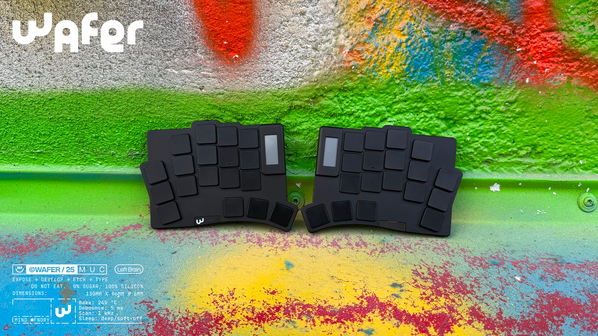
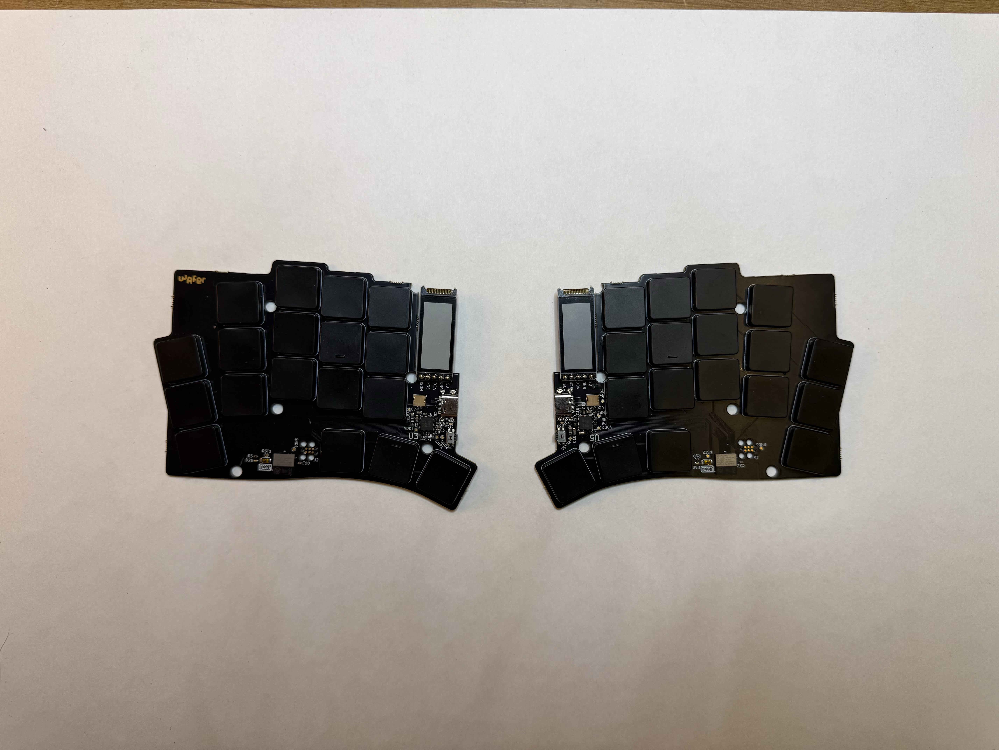
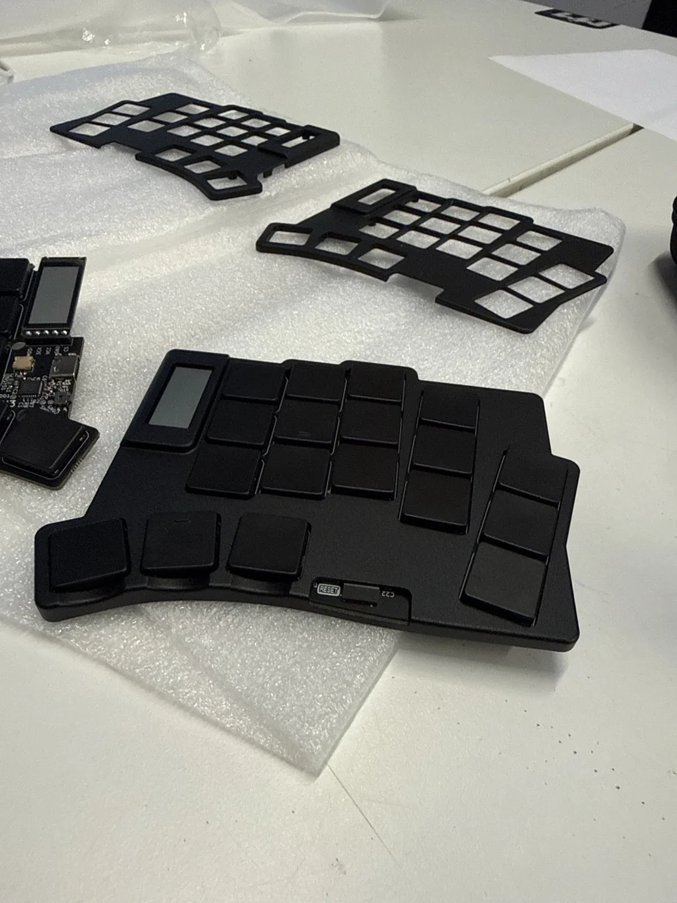
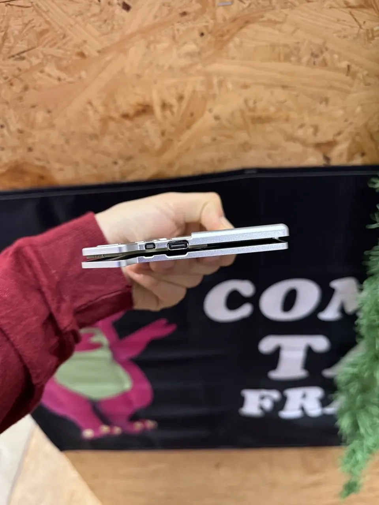
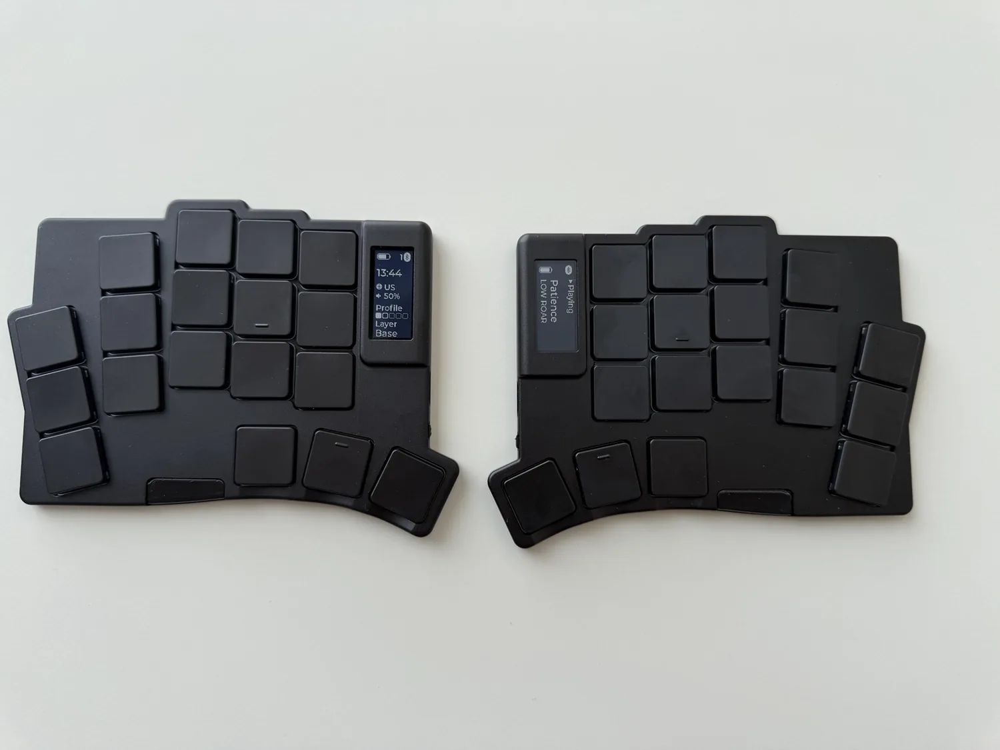
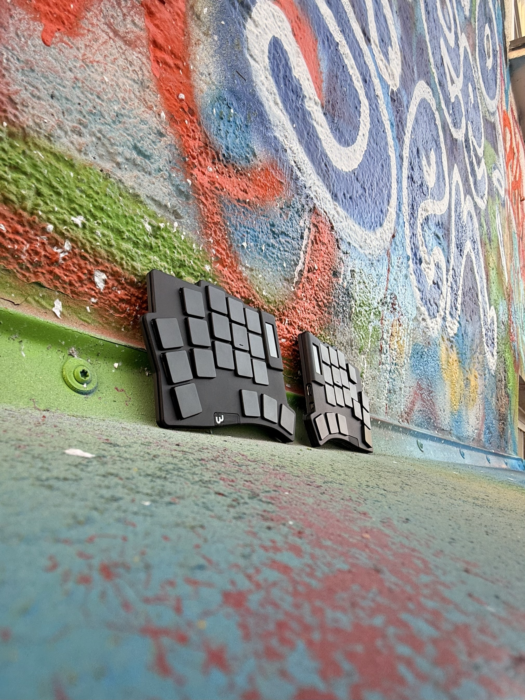
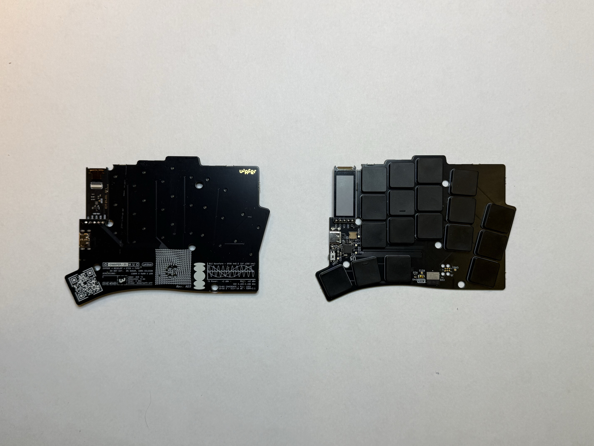
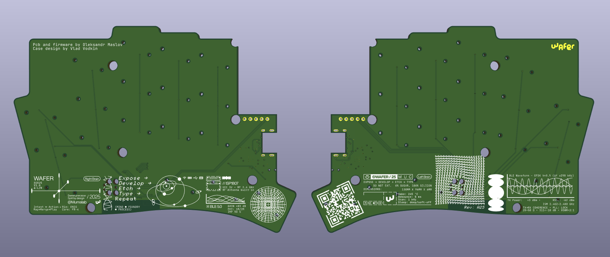

# Wafer

Wafer is a 36 key ultra-thin split keyboard that stays between 4–8 mm thick,
depending where you measure it. It runs on an ISP1807 with an nPM1300 PMIC, and
the full aluminium case snaps together with magnets for a clean profile.
Kailh PG1316S switches, a nice!view display and a 250 mAh LiPo in each half.
It runs ZMK over Bluetooth LE or USB.

More photos and the full story are on
[the project page](https://oleksandrmaslov.github.io/portfolio/Wafer.html).

The PCB, BOM and case models live here.
[ZMK firmware and configuration](https://github.com/oleksandrmaslov/wafer-zmk-config)
have their own repo.

***

## LAYOUT

36 keys, 18 per half, with three thumb keys on each side. The switches are Kailh
PG1316S, with PG1316 keycaps. The layout started in Ergogen; the board files are
in KiCad and the case models were made in Fusion 360.

The firmware repo has the standard QWERTY layout and build instructions. This
repo keeps the hardware files and manufacturing outputs.

***

## PCB

[Here](pcb/) you can find the PCB and production files for the Wafer. There are
two versions, with mousebites for production and without them:

- [PCB layout](pcb/wafer_keyboard_v3.kicad_pcb)
- [Production PCB](pcb/wafer_keyboard_v3_production.kicad_pcb)
- [Main schematic](pcb/wafer_keyboard_v3.kicad_sch) and [right schematic](pcb/wafer_keyboard_right.kicad_sch)
- [Gerber archive](pcb/jlcpcb/production_files/GERBER-wafer_keyboard_v3_production.zip)

The controller is an ISP1807 SiP with an nRF52840 and integrated antenna. The
nPM1300 handles charging and power, with a 250 mAh LiPo and one nice!view display
on each half. The board also has USB-C and Tag-Connect SWD access.

Original fabrication outputs and backups are kept alongside the editable sources.

***

## BOM

The full Bill of Materials for the Wafer keyboard is available here:

- [BOM (JLCPCB production)](pcb/jlcpcb/production_files/BOM-wafer_keyboard_v3_production.csv)
- [Component placement](pcb/jlcpcb/production_files/CPL-wafer_keyboard_v3_production.csv)
- [Original price breakdown](pcb/Keyboard%20Price.csv)

The price breakdown records the original order and parts used at the time.

***

## CASE

These models are for CNC:

- [Left case STEP](case/wafer_case_left.step)
- [Right case STEP](case/wafer_case_right.step)
- [Thread drawing](case/Wafer%20threads%20drawing.pdf)

The full aluminium case uses magnets to hold the halves together and to stick
to steel.

  
  

***

## PHOTOS

Art on the back:

And in KiCad:

***

## LICENSE

The hardware design files, documentation and photos by Oleksandr Maslov use
[CC BY-NC 4.0](LICENSE). You can study, share and modify them for noncommercial
use with attribution, a licence link and notice of changes.

Personal builds are allowed, including modified designs and paying a PCB
fabricator or CNC shop to make your own copies. Commercial production, kits and
paid builds for sale need separate written permission.
[MANUFACTURING.md](MANUFACTURING.md) has the permissions and commercial contact;
[photo credits](assets/README.md) has the image sources.

Firmware stays under MIT in its own repo. Third-party material keeps its own
applicable terms, and earlier licence grants remain valid.

Copyright (c) 2026 Oleksandr Maslov.

***

## CREDITS

### INSPIRATION

Inspired by the [Totem Keyboard](https://github.com/GEIGEIGEIST/TOTEM) and [Mikehive](https://github.com/mikeholscher/zmk-config-mikefive), but with a slimmer profile and magnets for usability. Big thanks to Rasmus for introducing me to the ISP1807.

### HELP FIXING THINGS

People who helped me create this board and fix stuff:

#### PCB

- [Rasmus Koit](https://github.com/rasmuskoit)
- [Eden](https://github.com/galaxyeden)
#### CASE

- [Vlad Vodkin (consulted me to build this case, huge thanks)](https://t.me/vlad30303)
